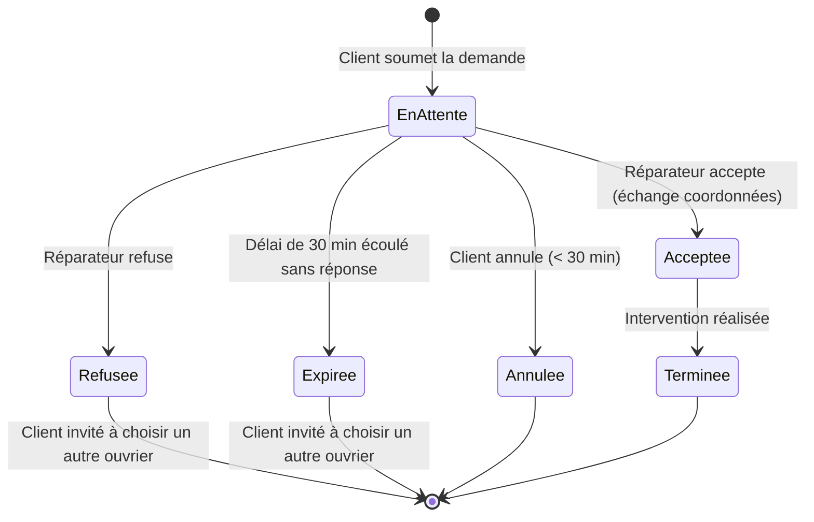
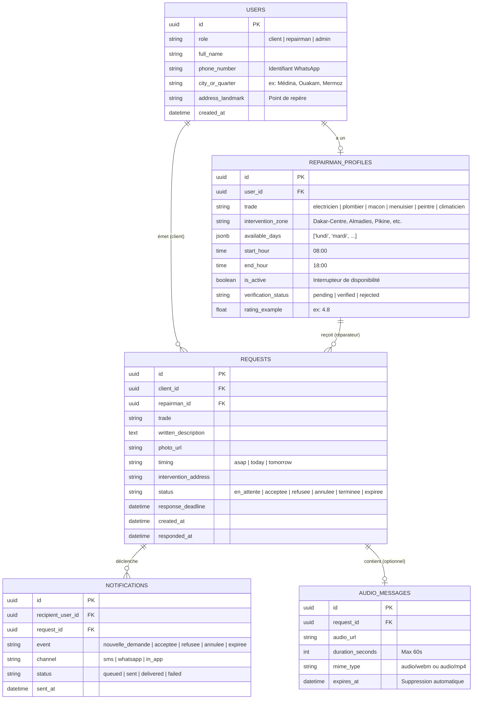

# Conception Technique & Analyse d'Implémentation — Allô Réparateur

Ce document formalise la conception technique, la modélisation des données, le cycle de vie des demandes et les réponses aux décisions ouvertes (Section 10) du cahier des charges de la plateforme **Allô Réparateur** (contexte Sénégal / Dakar).

---

## 1. Synthèse du Projet & Enjeux Clés

Le projet vise à connecter des particuliers et des artisans qualifiés (électricité, plomberie, maçonnerie, menuiserie, peinture, climatisation) via une application web mobile légère (390 px) adaptée aux contraintes locales :

| Enjeu | Défi identifié | Solution technique recommandée |
| :--- | :--- | :--- |
| **Illettrisme / Accessibilité** | Difficultés de lecture/écriture pour certains artisans et clients | **Option vocale prioritaire** (Web Audio API / MediaRecorder) + icônes explicites + synthèse vocale pour les consignes. |
| **Connectivité & Débit** | Connexion 3G/4G instable | PWA légère, compression audio/photo côté client avant téléversement, mise en cache locale. |
| **Fiabilité des notifications** | Les artisans ne restent pas sur le navigateur web | Notifications **SMS transactionnels** ou **WhatsApp Cloud API** déclenchées en temps réel. |
| **Confidentialité** | Risque de court-circuitage ou de harcèlement | Masquage des numéros et adresses jusqu'à l'acceptation explicite de la demande. |

---

## 2. Cycle de Vie d'une Demande (Machine à États)

Une demande suit un cycle strict à un seul réparateur à la fois.



### Règles de gestion critiques :
1. **Délai d'expiration dynamique** : Pour « Dès que possible », le réparateur dispose de **30 minutes** pour accepter. Passé ce délai, statut basculé sur `Expiree` et relance du client.
2. **Déverrouillage des coordonnées** : Le numéro WhatsApp/téléphone et l'adresse exacte ne sont exposés dans l'API qu'une fois le statut passé à `Acceptee`.
3. **Filtre de disponibilité active** : Un réparateur n'apparaît dans la recherche que si :
   - Son métier correspond exactement.
   - Sa zone géographique couvre celle du client.
   - Son interrupteur « Je suis disponible » est actif.
   - L'heure actuelle ou souhaitée est comprise dans sa plage horaire du jour.

---

## 3. Modèle de Données (Schéma Relationnel)



---

## 4. Architecture de l'Option Vocale & Audio

Pour garantir l'accessibilité aux artisans et clients non-lecteurs :

```
[Navigateur Client]
      │
      ├─ 1. Enregistrement Web Audio API (MediaRecorder)
      ├─ 2. Limitation à 60 secondes avec compte à rebours visuel
      ├─ 3. Pré-écoute locale (Blob audio) + option réenregistrement
      └─ 4. Compression (Opus / AAC ~ 32 kbps -> fichier < 250 Ko)
            │
            ▼
      [Stockage Audio Sécurisé / S3 / Supabase Storage]
            │
            ├─ URL signée temporaire (accès exclusif Client & Réparateur)
            └─ Cron de rétention : suppression 7 jours après la clôture
```

---

## 5. Arbitrages & Recommandations sur la Section 10

| Sujet | Proposition du CDC | Recommandation Technique & Opérationnelle |
| :--- | :--- | :--- |
| **1. Paiement** | Cash au MVP | **Maintenir Cash direct au MVP**, avec mention claire du montant convenu de gré à gré lors de l'appel après acceptation. Intégrer les liens Wave / Orange Money en Phase 2 via leurs APIs directes. |
| **2. Commission** | À fixer ultérieurement | **0% au MVP** pour maximiser l'adoption des artisans et éviter qu'ils ne contournent la plateforme. Test d'un abonnement mensuel fixe symbolique (ex: 3 000 FCFA/mois) en phase pilote. |
| **3. Avis & Notes** | Post-MVP | Afficher une note moyenne statique initiale (ex: 5.0 pour nouveau profil vérifié) et ajouter un retour binaire simple après intervention : « Réparation réussie ? Oui / Non ». |
| **4. Vérification** | Pièce d'identité + appel de contrôle | Workflow admin simple : statut `pending` à l'inscription de l'artisan. L'artisan ne peut recevoir de demandes qu'après validation d'un agent de la plateforme (appel téléphonique + photo CNI). |
| **5. Notifications** | SMS au départ | **SMS transactionnel direct (Twilio / Infobip / Orange SMS API)** avec un lien court direct vers la demande (`https://alloreparateur.sn/r/[id]`), complété par un bouton WhatsApp prêt à l'emploi. |
| **6. Métiers multiples** | 1 seul métier au MVP | **Un seul métier principal au MVP** pour simplifier le filtrage et les algorithmes de correspondance. |

---

## 6. Stack Technique Recommandée pour le MVP

- **Front-end & Mobile Web** : Next.js 14 / React avec Tailwind CSS (composants mobiles 390px, design tactile avec zones d'au moins 48px).
- **Enregistreur Vocal** : `MediaRecorder` HTML5 avec polyfill audio/webm et audio/mp4 pour compatibilité Safari iOS et Chrome Android.
- **Base de données & Auth** : Supabase (PostgreSQL + Row-Level Security pour masquer téléphones/adresses + Storage audio avec bucket privé).
- **Backend / Notifications** : API Routes Next.js / Node.js avec déclenchement asynchrone des SMS / webhooks.

---

## 7. Ajustements & Recommandations d'Amélioration Terrain

Suite à l'analyse pratique des contraintes du dépannage à domicile au Sénégal (Dakar et banlieue), voici 5 améliorations clés proposées pour optimiser le MVP :

### 1. Gestion de l'urgence : Réduction du délai (15 min) et « Rebond en 1 clic »
- **Constat** : 30 minutes d'attente pour une demande « Dès que possible » (panne d'électricité, fuite d'eau) est trop long. Le client risque d'abandonner l'application pour appeler une connaissance.
- **Ajustement** : 
  - Réduire le délai d'expiration à **15 minutes** pour les urgences (« Dès que possible »), tout en gardant 2h pour « Aujourd'hui » et 24h pour « Demain ».
  - Si l'artisan refuse ou ne répond pas dans les 15 min, afficher un bouton **« Transférer au réparateur suivant le plus proche »** : la demande et l'audio sont retransmis instantanément sans que le client n'ait à recommencer.

### 2. Notifications & Accès Artisan : Priorité WhatsApp + Liens Magiques
- **Constat** : Les SMS transactionnels internationaux coûtent cher et sont souvent pollués par les spams publicitaires d'opérateurs au Sénégal. WhatsApp est l'application la plus consultée par les artisans.
- **Ajustement** :
  - Notification prioritaire par WhatsApp (message formaté avec bouton d'action direct `wa.me` ou webhook).
  - Intégrer un **« Lien Magique » direct et sécurisé** : l'artisan clique sur le lien WhatsApp et arrive directement sur la fiche d'acceptation/refus sans avoir à saisir d'identifiant ni de mot de passe complexe.

### 3. Transparence Tarifaire : Forfait « Déplacement & Diagnostic »
- **Constat** : Le risque majeur de litige réside dans le déplacement à vide de l'artisan. À Dakar, un artisan refuse de se déplacer s'il n'est pas certain de couvrir au minimum ses frais de transport (souvent 2 000 à 3 000 FCFA).
- **Ajustement** :
  - Mentionner clairement dès l'écran 4 un **Forfait Déplacement & Diagnostic indicatif** (ex: 2 500 FCFA).
  - Ce montant est dû si le client décide de ne pas faire les réparations après le constat sur place, et est généralement déduit de la main-d'œuvre finale si la réparation est réalisée.

### 4. Flexibilité des compétences : Métier Principal + Secondaire (Max 2)
- **Constat** : Au Sénégal, beaucoup d'artisans sont polyvalents (électricien-climaticien, maçon-peintre, plombier-sanitaire). Bloquer à un seul métier réduit artificiellement le vivier disponible dans un quartier donné.
- **Ajustement** :
  - Permettre lors de l'inscription réparateur de cocher **1 métier principal + 1 métier secondaire optionnel**.

### 5. Accessibilité Vocale Bilingue (Français & Wolof) par clips audio natifs
- **Constat** : Les synthèses vocales automatisées des navigateurs (Web Speech API) ne supportent pas le Wolof et ont une voix robotique en français.
- **Ajustement** :
  - Intégrer des pastilles audio pré-enregistrées de 5 à 10 secondes en Wolof et Français pour les instructions clés (ex: « Appuyez sur le micro pour expliquer votre panne », « Comment accepter une demande »).

